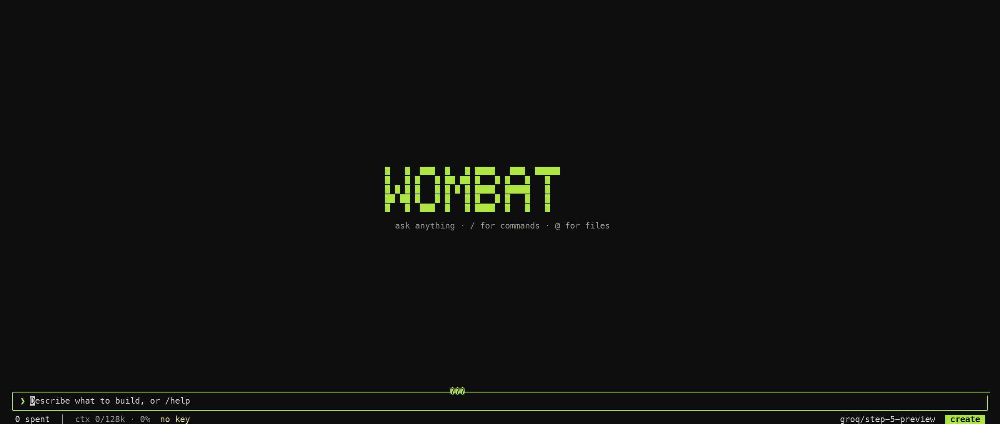
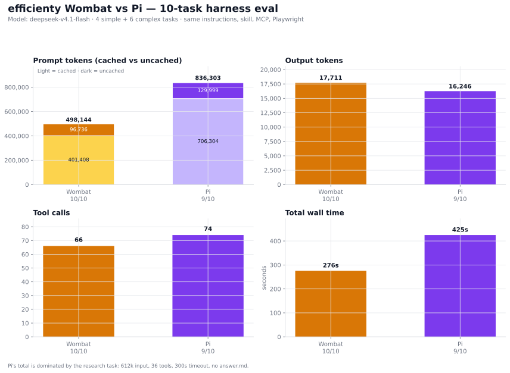
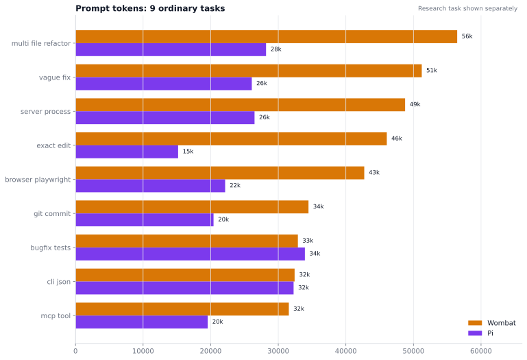
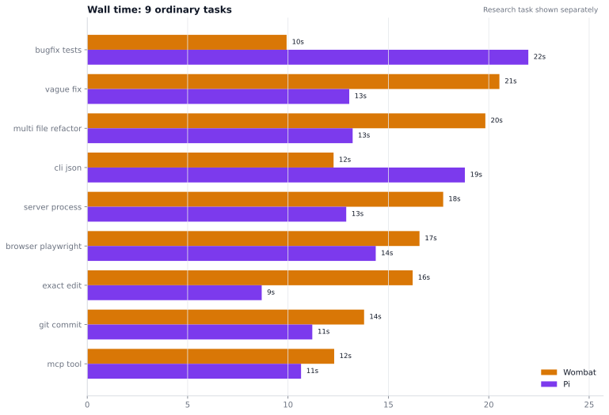
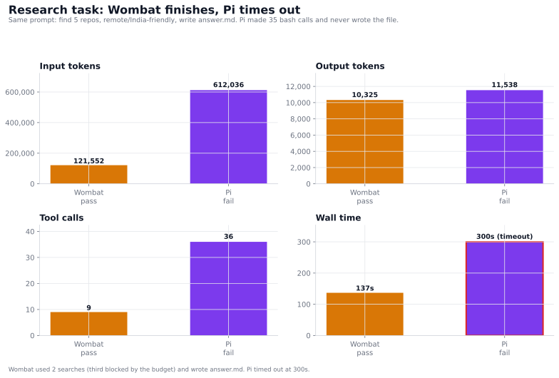
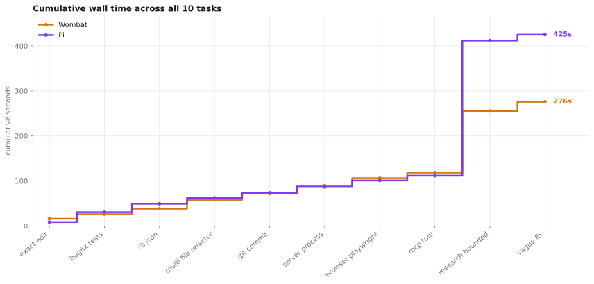

  
</p>
 
  <a href="https://github.com/ramsterr/Wombat/actions/workflows/ci.yml"></a>
  <a href="https://github.com/ramsterr/Wombat/releases"></a>
  <a href="https://github.com/ramsterr/Wombat/blob/main/go.mod"></a>
  <a href="LICENSE"></a>
</p>
 https://wombat-agent.vercel.app/
 
(wombat's site is made by wombat itself)


Wombat is a general purpose agent.
Can do anything and beyond than your standard agent harness , that too for lesser tokens at times.


## How it looks

Wombat works out of the box with the classic TUI. The new opentui UI is
optional: build it once and Wombat loads it automatically.

### Classic TUI (default)


Without the optional frontend build, this is what you get from the normal
install, `go install`, or a fresh clone. There is nothing extra to build, and
every Wombat feature works.

### New opentui UI (optional)

<p align="center">
  
</p>

**Don't want the old UI? Build it once:**

```bash
git clone https://github.com/ramsterr/Wombat.git
cd Wombat/tui
npm install
npm run build
cd ..
wombat
```

Use `./wombat` instead if you built the repo binary. Node **26.4+** is required.
Run Wombat from that checkout and the new UI loads automatically.

If you skip this step, `wombat` keeps using the classic TUI. The agent, tools,
sessions, and every feature work exactly the same; only the interface differs.

Switch back anytime with `wombat classic` (or `WOMBAT_CLASSIC=1 wombat`).

## Quick start

**macOS / Linux — latest release.** Install, configure, and start:

```sh
curl -fsSL https://raw.githubusercontent.com/ramsterr/Wombat/main/install.sh | bash
wombat setup
wombat
```

**Current `main` — newest features.** The tagged release can lag behind this
branch. With Go 1.26.3+:

```sh
go install github.com/ramsterr/Wombat/cmd/wombat@main
wombat setup
wombat
```

`go install` writes `wombat` to `$(go env GOPATH)/bin`; add that directory to
`PATH` if the command is not found. Update a release build with `wombat upgrade`;
rerun the `go install` command to update a `main` build (upgrade switches it to
the latest tagged release).

**Windows** — install WSL2 and Ubuntu (`wsl --install`), then run the
macOS/Linux command inside Ubuntu. Git Bash works for the native Windows build,
but Wombat's `bash` tool needs a POSIX `sh`; native PowerShell/cmd is not fully
supported.

`wombat setup` runs automatically on first launch and saves your provider,
model, and API key in `~/.wombat/config.json`.

## Install

The release installers below install the latest tagged release. Use the source
build when you want the current `main` features.

### Build from source (current main)

You only need Go 1.26.3+ and git. This fetches only the latest `main` commit and no old tags; omit the flags if you need full repository history.

```sh
git clone --depth 1 --single-branch --no-tags https://github.com/ramsterr/Wombat.git
cd Wombat
go build -o wombat ./cmd/wombat
./wombat version
./wombat setup
./wombat
```

Already have the checkout? Update it and rebuild the binary:

```sh
git pull
go build -o wombat ./cmd/wombat
./wombat
```

Install it somewhere on your PATH:

```sh
go build -o /usr/local/bin/wombat ./cmd/wombat
```

Requirements: Go 1.26.3+ for building from source. The core agent has no runtime
dependencies. Optional features use standard tools: a Chromium browser for
`browser`, a language server for `lsp`, git for isolated workers,
and `sh` for `bash`.

### Release installers

The one-line installer, Homebrew, and `go install ...@latest` install the
latest **tagged release**, not unreleased changes on `main`.

**macOS or Linux**

```sh
curl -fsSL https://raw.githubusercontent.com/ramsterr/Wombat/main/install.sh | bash
```

If `wombat` is not found:

```sh
echo 'export PATH="$HOME/.local/bin:$PATH"' >> ~/.zshrc
source ~/.zshrc
```

**Homebrew**

```sh
brew tap ramsterr/wombat
brew install ramsterr/wombat/wombat
```

**Go**

```sh
go install github.com/ramsterr/Wombat/cmd/wombat@latest
```

**Windows — WSL2**

Install Ubuntu from PowerShell with `wsl --install`, then run the macOS/Linux
installer inside Ubuntu. If `wombat` is not found, add `~/.local/bin` to your
`PATH` as shown above.

## First run

```sh
wombat setup       # choose a provider, paste an API key, choose a model
wombat doctor      # check config, permissions, and connectivity
wombat             # open the chat UI
```

`wombat setup` runs automatically on first launch. Your provider, model, and
API key are saved in `~/.wombat/config.json`.

Without a terminal UI:

```sh
wombat run "summarize this repository and find the test command"
wombat run --yolo "fix the failing tests and explain the change"
```

`--yolo` auto-approves tool permissions; use it for trusted, non-interactive
runs.

## Common commands

| command | what it does |
|---|---|
| `wombat` | open the chat UI |
| `wombat run "<task>"` | run one task and exit |
| `wombat run -c "<task>"` | continue the latest session |
| `wombat resume [id\|last]` | reopen a session |
| `wombat sessions` | list sessions for this directory |
| `wombat setup` | change provider, key, or model |
| `wombat models [provider]` | list available models |
| `wombat doctor` | diagnose config and connectivity |
| `wombat config` | show config, with keys redacted |
| `wombat config set <key> <value>` | change one setting |
| `wombat mcp add/list/test` | add and check MCP servers |
| `wombat mcp login/logout` | sign in to an OAuth MCP server |
| `wombat checkpoint list` | list shadow-git checkpoints |
| `wombat checkpoint restore <id>` | restore a checkpoint |
| `wombat upgrade` | install the latest stable release |
| `wombat version` | print the version |

## Inside the chat (new UI)

These shortcuts apply to the new opentui UI. If you skipped the optional build,
`wombat` starts the classic TUI instead; run `/help` there for its key map.

Type a request and press Enter. Useful shortcuts:

- `enter` — send; `shift+enter` — new line
- `esc` — stop the current run, close an overlay
- `ctrl+c` — quit
- `/` — command palette
- `@` — file picker with tab completion
- `ctrl+o` — open the live preview
- `ctrl+g` or `?` — help and key map
- `ctrl+t` — cycle colour themes
- `ctrl+p` / `ctrl+n` — prompt history
- `ctrl+r` — project references
- `ctrl+y` — copy the last reply; `/copy` opens the picker; `/copy all` copies
  the whole transcript
- `alt+2/3/4/5` — sessions, models, usage, doctor
- `pgup` / `pgdn` or `ctrl+up/down` — scroll the transcript
- click and drag — select text; the selection is copied automatically

Common slash commands:

```text
/help          keyboard map and every command
/keys          alias for /help
/reference     keep files and links for this project
/sources       browse the sites and files the session used
/preview [n]   open a preview; /previews lists them all
/copy [n|all]  pick a reply to copy, or copy the transcript
/model         switch model
/configure     choose and configure a provider
/providers     list every provider
/reasoning     off, low, medium, high, or max
/mode          chat or create mode
/attach <path> attach a file
/theme         open the live theme picker
/new           new session
/compact       compact context now
/status        current provider, model, and directory
/cost          token and cache usage
/exit          quit
```

# whats preview first?
agents are notorious for iterating for multiple minutes in the name of "improvement" and "polishing" without even making any considerable improvements.

wombat gives the user the power to review fast and feed back faster.
example:


Themes ship with the app: `wombat`, `tokyo`, `catppuccin`, `gruvbox`, `nord`,
`rosepine`, `dracula`, `everforest`, `kanagawa`, `solarized`, `monokai`,
`iceberg`, `nightfox`, `onedark`, and `github`. Pick one with `/theme`, or cycle
with `ctrl+t`; the choice is saved in `~/.wombat/config.json`. The opentui
interface uses a high-contrast dark treatment with a bright accent on the prompt.
The home screen shows the original wombat ASCII at its native character grid
(never stretched). The footer shows tokens spent, context used/total with a
percentage, the active model, and the mode. The classic interface still tints the terminal background while
Wombat is open (`wombat config set paint_background false` disables this).

**References** are project-scoped notes you can keep handy for a session.
Press `ctrl+r` to add a path or URL, or use `/reference add <path|url>`. Remove
them with `/reference rm <n>` or clear the list with `/reference clear`. They are
stored under `~/.wombat/references/`, never in your repository.

**Sources** (`/sources`) lists every site and file the session has used.

**Previews** are collected as the agent works: local dev servers, HTML pages,
PDFs, images, and video. They are de-duplicated by site origin or file path, the
newest is shown above the prompt, and `/previews` keeps the ordered
list. Use `ctrl+o` to open the newest or `/previews` to choose from all of them.

Wombat inherits your terminal's font; a terminal UI cannot install a font.
For the intended look and complete glyph set, use a Nerd Font such as JetBrains
Mono, Berkeley Mono, or MesloLGS NF in your terminal profile.

When the agent starts a local web server, a highlighted **preview ready** bar
appears above the prompt. Use `/preview` to open it, and `esc` to stop when it
looks right. For a new site, the agent builds the complete first version, checks
one desktop and one mobile view, then waits for your feedback before iterating.
Browser screenshots stay in memory and are not saved in the project.

## See other features

The features you expect from a serious coding agent, and the parts that make
Wombat different.

### Standard

| Feature | What it does |
|---|---|
| Code editing | Read, write, edit, and atomic multi-file patches. |
| Shell and jobs | Run commands, manage background jobs, run tests and builds. |
| Git | Use `bash git` for status, diff, log, and commits. |
| Verification | `verify`, browser assertions, and project checks. |
| Code intelligence | Language-server definitions, references, diagnostics, and completions. |
| Search | Glob and grep. |
| Web | Search and fetch with caching, retries, readable-text extraction, and page excerpts. |
| MCP | Add local stdio or remote HTTP/SSE Model Context Protocol servers, with interactive OAuth; their tools appear as `mcp__<server>__<tool>`. |
| Browser | Local and web automation, screenshots, clicks, typing, scrolling, and JS evaluation. |
| Media | Read images, video, audio, and documents; search images when enabled. |
| Sessions | Resumable sessions, browsing, continuation, and JSONL transcripts. |
| Context | Automatic pruning, summarization, compaction, and token accounting. |
| Checkpoints | Shadow-git snapshots with list and restore. |
| Permissions | Per-class gates for bash, writes, edits, network, sensitive reads, and each MCP server. |
| Providers | OpenAI-compatible APIs, Anthropic, OpenCode, and local model servers. |
| TUI basics | Command palette, file picker, history, copy, themes, and scrollback. |

### Unique

| Feature | What it does |
|---|---|
| Parallel fleet | Lead plus scouts and writers in isolated git worktrees; changes are reviewed and three-way merged. |
| Continuous plan scheduler | A dependency DAG where free slots start newly-ready work, slow steps do not block independent work, and interrupted steps resume. |
| Resumable workers | A worker that needs a decision returns `needs_input` and can be resumed in the same session and worktree. |
| Visual hand-off gate | After the complete visual deliverable, Wombat asks `Looks good` / `Needs changes` at the end of the run; headless runs never stop mid-build for a review. |
| Multi-preview system | Detects local servers, HTML, PDFs, images, and video; de-duplicates by origin or path; shows the newest above the prompt and keeps a `/previews` picker. |
| Source browser | `/sources` browses every site and file the session used, with counts and open/attach actions. |
| Project references | `ctrl+r` / `/reference` keeps files, folders, and URLs in a per-project reference list under `~/.wombat/references/`. |
| Centered chat | A calm, opencode-style conversation column with the wombat art centred on the welcome screen and a live status footer. |
| Search ranking | Merges Brave, Serper, Exa, Tavily, Bing RSS, DuckDuckGo, and Mojeek; boosts trusted docs, engine position, and cross-engine hits; filters adult/SEO spam; caps domains. |
| Image search | Finds direct image URLs via Google Images (Serper), Brave, DuckDuckGo, and Openverse, and downloads them into the workspace. |
| Provider setup | `/configure` opens a base URL/API-key form; unconfigured models stay selectable but show `no key` and are blocked from chat. |
| Reasoning picker | After selecting a reasoning model, choose `off`, `low`, `medium`, `high`, or `max`; `/reasoning` reopens it. |
| Themes | Fifteen palettes, a live picker, `ctrl+t` cycling, and a reclaimed terminal background in the classic interface. |
| Copy | `ctrl+y` for the last reply and `/copy` for any user, agent, or tool output, with an OSC 52 fallback. |
| File picker | `@` path completion with directory navigation and quoted paths for spaces. |
| Built to be driven | Headless `wombat run`, scriptable sessions, and a TUI designed around a centred chat, a live footer, and keyboard flow. |

## Coming next

- Images in the terminal
- Premade environments for specific kinds of tasks
- Agent observability
- Source tracking
- Personalisation

## Parallel agents

Workers are full-access by default. They can read, write, edit, run commands,
use the network, browse, generate images, and use the coding/research toolset.
Orchestration tools and `question` stay with the lead.

- `delegate_many` runs independent workers in one wave. Tasks can declare `id` and `depends_on` to form a DAG; dependents wait for their upstream reports, which are added to their context.
- `run_plan` executes the ledger as a dependency graph with continuous scheduling. Free slots start newly-ready work instead of waiting for a slow step; writers can review and merge while scouts are still running; long dependency chains are scheduled first; timed-out/transient steps retry once; and slots are shared between scouts and writers. `background=true` returns immediately, `cancel=true` stops the plan, and canceled or interrupted steps stay pending so a later `run_plan` resumes them.
- `delegate_write` gives writers explicit file ownership; writes outside the declared files are refused.
- `resume_worker` answers a worker that reported `needs_input` and continues the same session and worktree.
- Selected custom agents (see below) are first-class workers: `update_plan` steps take an `agent` id, the planner runs them in parallel by dependency, and dependent steps receive the upstream report.
- Workers run in git worktrees when possible; warm worktrees are reused between steps, changes are reviewed and merged, and checks run once before merge.
- Token budgets are unlimited by default. `max_parallel_scouts` and
  `max_parallel_writers` limit concurrency.
- `check_policy` controls where checks run (`auto`, `worktree`, `merge`, `both`) and `review_policy` controls writer review (`always`, `auto`, `never`).

Use workers for independent files, categories, pages, or audits. Do not use
them for a single shell command or for several agents reading the same data.

```text
Use update_plan to make a scout step and two write steps with disjoint files,
then call run_plan.
```

Set `worker_full_access false` for read-only research workers.

## Custom agents

Custom agents are specialists you define once and select per session. Each
one has its own system prompt, skills, tool allowlist, permissions, MCP
servers, and optional model/provider. The planner coordinates every selected
specialist with the default agent, running independent steps in parallel and
handing each dependent step its upstream report.

Create a definition:

```sh
wombat agent new math-research
wombat agent list
```

This writes `~/.wombat/agents/math-research.json` (or
`.wombat/agents/<name>.json` inside a project that already has `.wombat`).
Edit it:

```json
{
  "name": "math-research",
  "description": "Verifies mathematical claims and writes clear proofs",
  "prompt": "You are a rigorous mathematician. Justify each step and cite sources.",
  "model": "",
  "tools": ["read", "grep", "websearch", "webfetch"],
  "mcp_servers": [],
  "permissions": { "write": "deny" },
  "skills": ["careful-proofs"],
  "readonly": true
}
```

Definitions can also be markdown with a flat frontmatter block, and skills are
markdown files in `~/.wombat/skills/<name>.md` or `.wombat/skills/<name>.md`
(project wins on conflicts). Every definition may set:

| Field | Meaning |
| --- | --- |
| `description` | When the planner and picker should use this agent. |
| `prompt`, `prompt_file` | The agent's system prompt, inline or from a file. |
| `provider`, `model` | Run this agent on a different provider/model. |
| `tools` | Allowlist of names, globs (`web*`), classes (`class:read`), or `mcp:<server>`. Empty means every worker-eligible tool. |
| `exclude_tools` | Remove tools that would otherwise be included. |
| `mcp_servers` | Restrict the agent to the named MCP servers. |
| `permissions` | `allow` or `deny` for `bash`, `write`, `edit`, `network`, `dangerous`, `sensitive-read`, `outside`, `mcp`, `mcp:<server>`. Custom agents never prompt, so `ask` is rejected; credentials reads and dangerous commands stay denied unless explicitly allowed. |
| `skills` | Skill names whose instructions are appended to the prompt. |
| `max_steps` | Per-run step budget (0 uses the session default). |
| `readonly` | Blocks writes, edits, and mutating commands. |

Select agents in the TUI with `/agents`. The picker is a multi-select list
with a **Create a new agent…** row (also `c`). Create opens a sectioned
builder for basics, system prompt, tools, MCP servers, permissions, skills,
and options, then writes the definition file and returns to the picker.
`space` toggles an agent, `a` selects all or none, and `enter` applies the
selection. Power users can also use `/agents math-research,design`, `/agents
clear`, or `/agents list`. Selections are saved on the session and restored
by `wombat resume`. Headless runs take the same selection:

```sh
wombat run --agents math-research,design "research MCTS and design a deck"
```

With no agents selected the default agent plans and works exactly as before.
Chat mode forces every selected agent read-only. `max_parallel_agents`
(default 5) caps how many custom agents run at once.

Skills are reusable instruction files. `/skill` (or `/skills`) opens the
skills browser, with `enter` expanding the selected skill, `/skill <name>`
printing it in full, and `/skill list` printing every installed skill with
its source and the agents that enable it. Enable skills per agent with the
builder's Skills section or the `skills` field.

A planning example: the default agent plans `research` (agent: math-research)
→ `design` (agent: design, depends_on: research) → assembles the deck itself.
Research and any independent step run in the first wave; design starts as
soon as research completes and receives its findings automatically.

## Configuration

Show the current configuration:

```sh
wombat config
```

### Web search and fetch

`websearch` runs the available backends in parallel — Brave, Serper, Exa, and
Tavily when configured, plus Bing RSS, DuckDuckGo HTML, and Mojeek RSS — then
merges, cross-checks, and ranks their results. It accepts 2–4 query variants,
`freshness`, `language`, `region`, and pagination; searches retry transient
failures and allow up to 15 seconds, with a 5-second grace window after the
first backend replies. By default it also fetches the top three pages and adds
a relevant excerpt plus any date and author it can find; `depth=deep` fetches
up to six pages and `depth=fast` skips page fetching. Official docs, GitHub,
and trusted domains are boosted, engine position and Exa results carry extra
weight, tracking parameters are removed, adult and SEO-spam hits are filtered,
and a domain can contribute at most three results. Backend failures are
reported instead of hidden. Scraped backends use strict safe search. Results
are cached for ten minutes. Set `EXA_API_KEY`, `TAVILY_API_KEY`,
`BRAVE_API_KEY`, or `SERPER_API_KEY` before starting Wombat to use your own
search account:

```sh
export EXA_API_KEY=...
export TAVILY_API_KEY=...
export BRAVE_API_KEY=...
export SERPER_API_KEY=...
```

`webfetch` extracts the main article text with its title and description,
pretty-prints JSON, returns text/XML, and gives a clear note for PDFs and
binary payloads. It caches responses for repeated reads, retries transient
connection failures, and shares a 15-second HTTP client with search.

`imagesearch` returns direct image URLs from Google Images (through Serper),
Brave Images, DuckDuckGo Images, and Openverse, and can download the selected
images into the workspace. Set `SERPER_API_KEY` for Google Images or
`BRAVE_API_KEY` for Brave Images; DuckDuckGo and Openverse work without a key.

### MCP servers
example:


Wombat is an MCP client. Add local stdio servers or remote Streamable HTTP/SSE
servers; their tools appear to the agent as `mcp__<server>__<tool>`.

**Commands**

```sh
# local stdio
wombat mcp add playwright -- npx -y @playwright/mcp@latest
wombat mcp add github --env GITHUB_TOKEN=... -- \
  npx -y @modelcontextprotocol/server-github

# remote HTTP with a static token
wombat mcp add context7 --url https://mcp.context7.com/mcp
wombat mcp add github --url https://api.githubcopilot.com/mcp/ \
  --header 'Authorization=Bearer ${GITHUB_TOKEN}'

# manage and inspect
wombat mcp list
wombat mcp test [name...]
wombat mcp enable <name>
wombat mcp disable <name>
wombat mcp remove <name>
wombat mcp import .mcp.json
```

`wombat mcp test` connects, lists the server's tools, and shows errors and
server stderr. Startup defaults to 15 seconds; use `--timeout 60` for a slow
first `npx` download and `--call-timeout 600` for slow tools. `import` accepts
the Claude Code/Cursor `mcpServers` format and the OpenCode `mcp.servers` format.

**Interactive OAuth**

```sh
wombat mcp add notion --url https://mcp.notion.com/mcp
wombat mcp login notion
wombat mcp test notion
wombat mcp logout notion
```

`mcp login` opens the browser, completes a loopback OAuth callback with PKCE
and state checks, and stores access and refresh tokens in
`~/.wombat/mcp-auth/` with `0600` permissions. Tokens refresh automatically.
Agent startup uses cached tokens only and reports
`run wombat mcp login <server>` when a login is missing. `logout`, updating, or
removing a server clears the saved login.

Use `"oauth": false` for API-key servers, or set `oauth_client_id`,
`oauth_client_secret`, `oauth_scopes`, and `oauth_redirect_url` for a
pre-registered client. Remote MCP endpoints must use HTTPS unless they are
loopback. Some providers restrict OAuth registration to approved clients; use a
PAT-based or local server variant instead.

**In chat**

`/mcp` shows each attached server, its tools, status, and this session's call
counts.

**Config and permissions**

Servers live under `mcp_servers` in `~/.wombat/config.json`:

```json
{
  "mcp_servers": {
    "filesystem": {
      "type": "stdio",
      "command": "npx",
      "args": ["-y", "@modelcontextprotocol/server-filesystem", "."],
      "class": "read"
    },
    "context7": {
      "type": "http",
      "url": "https://mcp.context7.com/mcp",
      "headers": {"Authorization": "Bearer ${CONTEXT7_API_KEY}"}
    }
  }
}
```

`${VAR}`, `${VAR:-default}`, and `{env:VAR}` expand when the server starts, so
secrets can stay in the environment. MCP calls are gated by
`mcp:<server>`, falling back to `mcp`, which defaults to `ask`:

```sh
wombat config set permissions.mcp allow
wombat config set permissions.mcp:github ask
```

Use `--class read` to let delegated scouts use a read-only server; other servers
stay lead-only unless you pass `--workers`. Local servers run as your user with
your environment, so only add servers you trust.

### Common settings

```sh
wombat config set provider openai
wombat config set model gpt-5
wombat config set mode create
wombat config set tool_profile auto
wombat config set research_mode auto
wombat config set capabilities.semantic off
wombat config set fallback_models gpt-5-mini
wombat config set scout_model gpt-5-mini
wombat config set worker_full_access false
wombat config set review_writers false
wombat config set check_policy auto
wombat config set review_policy always
wombat config set max_parallel_scouts 5
wombat config set permissions.bash ask
```

The file lives at `~/.wombat/config.json`. API keys can also come from provider
environment variables (`OPENAI_API_KEY`, `ANTHROPIC_API_KEY`, and so on).
`wombat setup` is the easiest way to create the config.

## Troubleshooting

**`wombat: command not found`**

Add `~/.local/bin` to `PATH`, or run the binary by its full path.

**No provider or model**

Run `wombat setup`, then `wombat doctor`.

**Writers fail with “main workspace has tracked changes”**

Commit or stash tracked changes first. Workers use git worktrees and need a
clean tracked tree.

**Connection reset by peer**

Wombat retries transient connection errors automatically, including after part
of a response has streamed. It clears the partial output, retries with backoff,
and asks the model to continue if the provider retries are exhausted. If it
still fails, check your network, proxy, or VPN and retry.

**No preview bar appears**

The preview bar only appears after a tool reports a local URL such as
`http://localhost:5173`.

**An upgrade replaced my source build**

`wombat upgrade` installs the latest tagged release. Rebuild from source to
stay on the current `main`.

## Uninstall

Delete the binary and, if you want to remove settings and sessions too:

```sh
rm -f ~/.local/bin/wombat
rm -rf ~/.wombat
```

## Development

```sh
gofmt -w .
go vet ./...
go test ./...
go build -o /tmp/wombat ./cmd/wombat
```

CI runs on the default branch and on pull requests. Issues and pull requests
are welcome.

## Benchmarks

Every benchmark uses the same model, instructions, skill content, MCP server,
and workspace for both agents. Raw data, task definitions, and chart generators
live under [`eval/benchmarks/`](eval/benchmarks).

### Wombat vs Pi: 10-task efficiency run

Both agents ran the same 4 simple and 6 multi-step tasks on
`deepseek-v4.1-flash`.



| Metric | Wombat | Pi |
|---|---:|---:|
| Tasks passed | **10/10** | **9/10** |
| Input tokens | 498,144 | 836,303 |
| Output tokens | 17,711 | 16,246 |
| Tool calls | 66 | 74 |
| Model steps | 61 | 64 |
| Wall time | 275.9s | 424.9s |

Wombat finished the bounded research task; Pi has no native search tool, made
35 bash calls, accumulated 612k input tokens, and timed out at 300s without
writing `answer.md`. That one failure skews the totals.

On the nine non-research tasks, Pi was the leaner harness:

| Ordinary tasks only | Wombat | Pi |
|---|---:|---:|
| Input tokens | 376,592 | 224,267 |
| Output tokens | 7,386 | 4,708 |
| Tool calls | 57 | 38 |
| Wall time | 139.1s | 124.9s |









The full write-up has the task list, per-task table, method, raw data, and
limitations: [`efficienty-10/README.md`](eval/benchmarks/pi-vs-wombat/efficienty-10/README.md).

### Other comparisons

- [Wombat vs Pi](eval/benchmarks/pi-vs-wombat/README.md) — 18
  harness-capability tasks, plus the efficiency investigation on branch
  `efficienty`.


   
