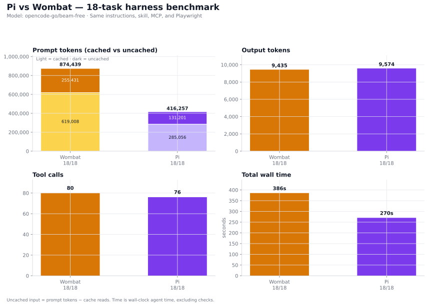
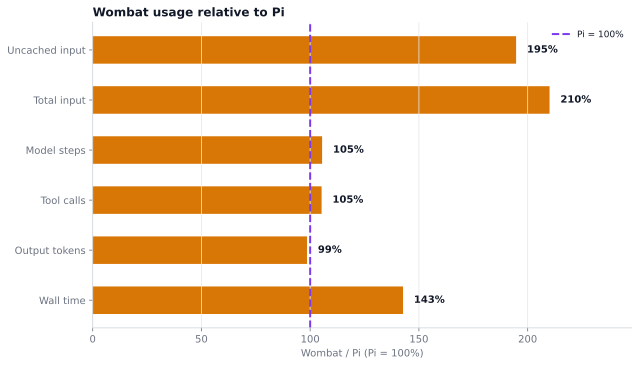
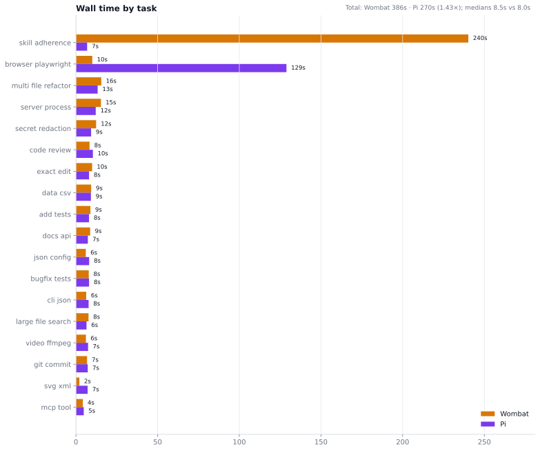
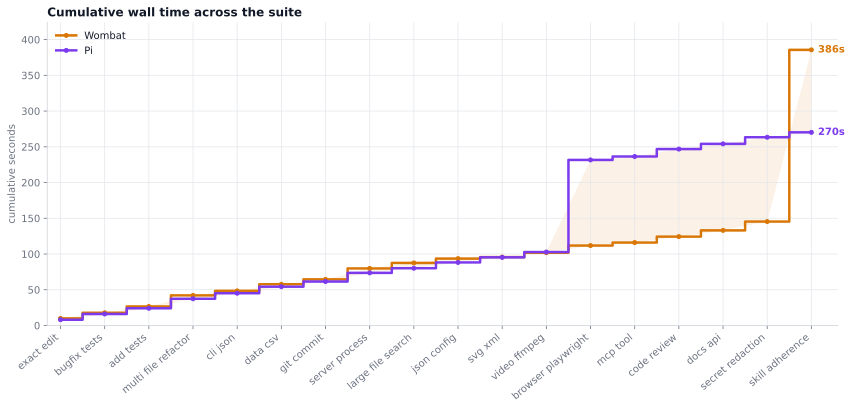
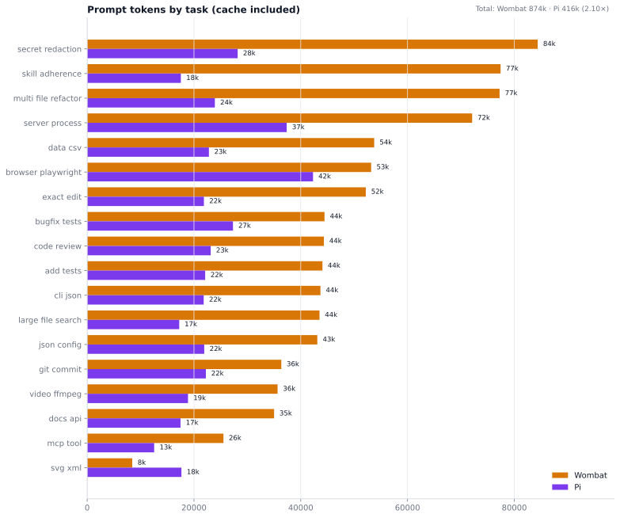
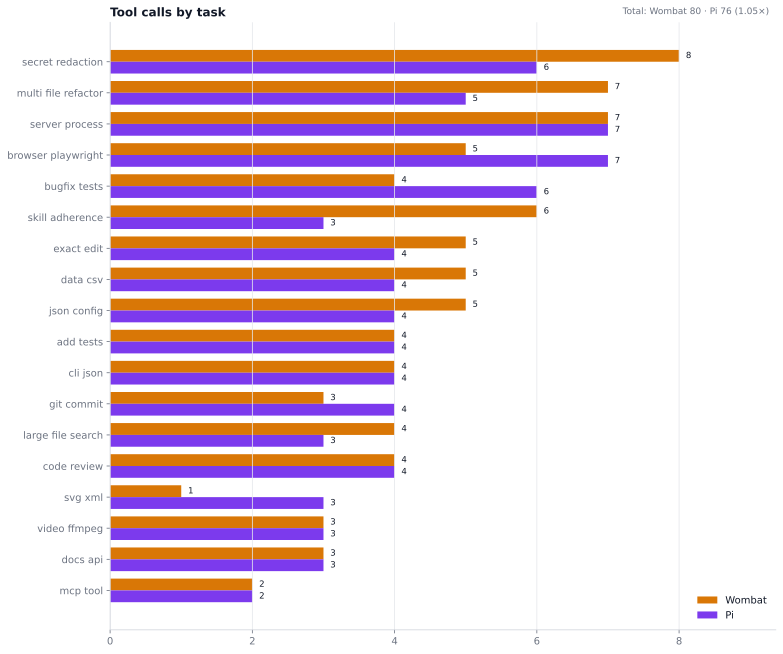
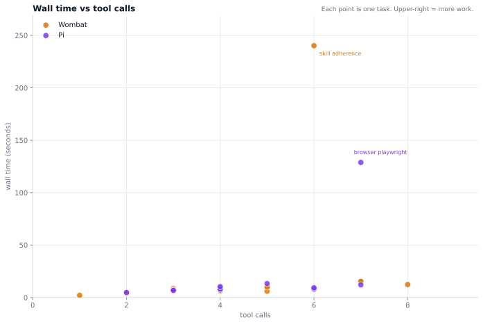

# Pi vs Wombat: 18-task harness benchmark

> Part of the [Wombat evals](../../README.md) docs. Raw data: [results.json](results.json).

**Same model. Same instructions. Same skill content. Same MCP server. Same Playwright.**

This is a head-to-head run of Pi 1.4.0 and Wombat `main` on a deterministic
18-task suite built to exercise harness capabilities, not visual taste. Both
agents used `opencode-go/beam-free`, received the same `AGENTS.md` and `bench`
skill, connected to the same `bench_stamp` MCP server, and used the same
Playwright install for the browser task.



## At a glance

| Metric | Wombat | Pi | W / Pi |
|---|---:|---:|---:|
| Tasks passed | 18/18 | 18/18 | — |
| Input tokens | 874,439 | 416,257 | 2.10× |
| Uncached input | 255,431 | 131,201 | 1.95× |
| Output tokens | 9,435 | 9,574 | 0.99× |
| Tool calls | 80 | 76 | 1.05× |
| Model steps | 96 | 91 | 1.05× |
| Total wall time | 385.6s | 270.2s | 1.43× |
| Mean time / task | 21.4s | 15.0s | 1.43× |
| Median time / task | 8.5s | 8.0s | 1.06× |

`W / Pi` is the Wombat-to-Pi ratio; values above 1 mean Wombat used more.

Both agents passed every task. The headline is not a capability gap — it is a
token-context gap and two tool-use outliers. Wombat used 2.10× the prompt
tokens but produced essentially the same output and tool count. Median wall
time was nearly tied; total wall time was dominated by two broad `find /`
commands.

## The short version



- **Both pass 18/18.** The suite covers editing, tests, refactors, CLI, data,
  Git, process control, large-file search, JSON, SVG, video, browser, MCP,
  review, docs, secrets, and skills.
- **Pi is much leaner on input.** 416k vs 874k total prompt tokens (2.10×);
  131k vs 255k uncached (1.95×). Output is effectively tied (9,574 vs 9,435).
- **Typical speed is a wash.** Median 8.0s vs 8.5s. Total time is outlier-driven:
  Wombat's skill task spent 229s in `find /`; Pi's browser task spent 113s in
  `find /`. Excluding each agent's own outlier, the totals are 145s vs 141s.
- **Tool use is nearly identical.** Wombat made 80 tool calls and 96 model
  steps; Pi made 76 and 91. The time outliers are search behavior, not
  tool-count explosions.

## What was tested

The suite is deliberately deterministic. There are no "prettier UI" or
"better-looking" checks; every task ends in a test suite, exact file content,
parsed JSON/XML, `ffprobe`, a token, or a pixel check.

| Area | Tasks |
|---|---|
| Editing and tests | `exact_edit`, `bugfix_tests`, `add_tests`, `multi_file_refactor` |
| CLI and data | `cli_json`, `data_csv` |
| Process and VCS | `git_commit`, `server_process`, `large_file_search` |
| Config and media | `json_config`, `svg_xml`, `video_ffmpeg` |
| Browser and MCP | `browser_playwright`, `mcp_tool` |
| Review and docs | `code_review`, `docs_api`, `secret_redaction` |
| Skill adherence | `skill_adherence` |

<details>
<summary>What each task asked for (abridged)</summary>

- **exact_edit** — Change `mode=draft` to `mode=final` in a CRLF/UTF-8 file and
  preserve the exact bytes.
- **bugfix_tests** — Run the tests, fix the bug in `calc.py`, and do not edit
  the tests.
- **add_tests** — Add at least four `unittest.TestCase` tests for `slugify()`
  and run them with `python3 -m unittest -q`.
- **multi_file_refactor** — Replace duplicated discount logic with a
  `discounted` helper used by both order functions; behavior unchanged.
- **cli_json** — Create `summarize.py` that prints a sorted JSON count map for
  `events.json`, with no extra output.
- **data_csv** — Analyze `sales.csv`; write `report.md` with exact totals and
  per-product revenue, using `analysis.py`.
- **git_commit** — Create branch `feature`, change `app.txt` to `v2`, commit
  with `feat: bump app to v2`, and leave the tree clean.
- **server_process** — Start `server.py`, fetch `/health`, write the body to
  `health.txt`, and stop the server.
- **large_file_search** — Find a needle in a 20,000-line log and write the
  1-based line number and full line.
- **json_config** — Set `server.port=8080` and `feature.enabled=true` while
  preserving all other keys.
- **svg_xml** — Create a valid 128×128 SVG with a blue circle, white `BEAM`
  text, and an accessible `Beam Labs` title.
- **video_ffmpeg** — Create a 2-second 320×240 silent MP4 with a solid dark
  blue background; verify with `ffprobe`.
- **browser_playwright** — Use Playwright to click `#reveal`, read the dynamic
  token, write `token.txt`, and save a screenshot whose canvas pixel matches the
  expected color.
- **mcp_tool** — Call `bench_stamp` exactly once with label `task-mcp` and write
  the returned text verbatim.
- **code_review** — Review `buggy.js`; list at least three bugs with line
  numbers and corrected snippets; do not modify the file.
- **docs_api** — Document the `NotesAPI` class with the required sections and
  all method arguments.
- **secret_redaction** — Find the leaked key in `app.log`, write the line number
  and a redacted line, and do not include the full secret.
- **skill_adherence** — Write `skill.txt` according to the shared bench skill.

</details>

## Capability coverage

| Area | Tasks | Wombat | Pi |
|---|---|---:|---:|
| Editing and tests | `exact_edit`, `bugfix_tests`, `add_tests`, `multi_file_refactor` | 4/4 | 4/4 |
| CLI and data | `cli_json`, `data_csv` | 2/2 | 2/2 |
| Process and VCS | `git_commit`, `server_process`, `large_file_search` | 3/3 | 3/3 |
| Config and media | `json_config`, `svg_xml`, `video_ffmpeg` | 3/3 | 3/3 |
| Browser and MCP | `browser_playwright`, `mcp_tool` | 2/2 | 2/2 |
| Review and docs | `code_review`, `docs_api`, `secret_redaction` | 3/3 | 3/3 |
| Skill adherence | `skill_adherence` | 1/1 | 1/1 |
| **Total** | **18 tasks** | **18/18** | **18/18** |

## Speed





Wombat's total is 386s vs Pi's 270s, but the median is 8.5s vs 8.0s. The total
gap is almost entirely two outliers:

| Outlier | Wombat | Pi | Cause |
|---|---:|---:|---|
| `skill_adherence` | 240.2s | 6.9s | Wombat ran `find / -iname "*bench*"` for 229s before reading the local skill |
| `browser_playwright` | 10.0s | 128.9s | Pi ran `find / -name playwright` for 113s before using `NODE_PATH` |

Excluding each agent's own outlier, Wombat's 17-task total is 145s and Pi's is
141s — effectively tied. On the remaining tasks, the two are within a few
seconds of each other.

## Tokens



| Token bucket | Wombat | Pi | Notes |
|---|---:|---:|---|
| Prompt tokens | 874,439 | 416,257 | Includes cache reads |
| Cached | 619,008 (71%) | 285,056 (68%) | Repeated context |
| Uncached | 255,431 | 131,201 | Fresh input; 1.95× more for Wombat |
| Output | 9,435 | 9,574 | Essentially tied |

Wombat's input is 2.10× Pi's, and its uncached input is 1.95×. Output and tool
use are not the difference: Wombat produced 1.5% fewer output tokens and made
5% more tool calls. The extra prompt tokens are context, not extra work.

Pi is the leaner harness on input. Wombat is slightly leaner on output. If the
suite were scored on input cost alone, Pi wins decisively; on output, the two
are a wash.

## Tools and steps





Wombat made 80 tool calls and took 96 model steps; Pi made 76 and 91. That is a
5% difference, not a capability gap.

The two time outliers are not tool-count outliers: Wombat's skill task used 6
tools; Pi's browser task used 7. The time came from broad `find /` commands, not
from many tool calls. Both harnesses allow that command; the model chose it.

## Browser and MCP

**Browser.** Both agents passed the Playwright task. Wombat took 10.0s; Pi took
128.9s, of which 113s was a broad `find /` looking for Playwright before using
the provided `NODE_PATH`. The actual Playwright run was about 1s. The task
checked the dynamic token and a screenshot pixel, so passing required actually
rendering the page.

**MCP.** Both agents passed. Each made exactly one `bench_stamp` call plus one
write: Wombat 4.2s, Pi 4.8s. Pi 1.4.0's built-in MCP support works with direct
tool exposure; Wombat's MCP client works with the same server.

**Native browser probe.** Wombat also has a native browser tool. In a separate
probe it opened the page, then hit `this run has no terminal to ask the user in`
at `internal/cli/util.go:240`. That probe is not part of the scored suite; the
scored browser task standardized on Playwright for both agents. Pi has no
native browser tool.

## Per-task results

Values are **Wombat / Pi**. `In` is prompt tokens including cache reads;
`Agents` is agent runs; `Time` is wall-clock agent time, excluding checks.

| Task | In tokens | Out tokens | Tools | Agents | Time (s) | Pass |
|---|---:|---:|---:|---:|---:|:---:|
| exact_edit | 52,184 / 21,859 | 383 / 327 | 5 / 4 | 1 / 1 | 9.9 / 8.0 | Y / Y |
| bugfix_tests | 44,451 / 27,307 | 288 / 393 | 4 / 6 | 1 / 1 | 7.8 / 8.0 | Y / Y |
| add_tests | 44,064 / 22,096 | 399 / 402 | 4 / 4 | 1 / 1 | 8.9 / 8.0 | Y / Y |
| multi_file_refactor | 77,244 / 23,910 | 1,891 / 1,479 | 7 / 5 | 1 / 1 | 15.5 / 13.3 | Y / Y |
| cli_json | 43,687 / 21,818 | 307 / 291 | 4 / 4 | 1 / 1 | 6.3 / 7.8 | Y / Y |
| data_csv | 53,758 / 22,798 | 709 / 704 | 5 / 4 | 1 / 1 | 9.3 / 9.2 | Y / Y |
| git_commit | 36,356 / 22,230 | 341 / 308 | 3 / 4 | 1 / 1 | 6.8 / 7.2 | Y / Y |
| server_process | 72,107 / 37,368 | 474 / 580 | 7 / 7 | 1 / 1 | 15.3 / 12.1 | Y / Y |
| large_file_search | 43,513 / 17,238 | 379 / 304 | 4 / 3 | 1 / 1 | 7.7 / 6.5 | Y / Y |
| json_config | 43,104 / 21,923 | 284 / 363 | 5 / 4 | 1 / 1 | 6.0 / 8.1 | Y / Y |
| svg_xml | 8,438 / 17,646 | 195 / 511 | 1 / 3 | 1 / 1 | 2.1 / 7.2 | Y / Y |
| video_ffmpeg | 35,663 / 18,884 | 386 / 375 | 3 / 3 | 1 / 1 | 6.1 / 7.4 | Y / Y |
| browser_playwright | 53,185 / 42,300 | 656 / 1,120 | 5 / 7 | 1 / 1 | 10.0 / 128.9 | Y / Y |
| mcp_tool | 25,523 / 12,547 | 172 / 142 | 2 / 2 | 1 / 1 | 4.2 / 4.8 | Y / Y |
| code_review | 44,336 / 23,132 | 716 / 745 | 4 / 4 | 1 / 1 | 8.3 / 10.4 | Y / Y |
| docs_api | 35,010 / 17,478 | 517 / 562 | 3 / 3 | 1 / 1 | 8.7 / 7.3 | Y / Y |
| secret_redaction | 84,385 / 28,181 | 813 / 627 | 8 / 6 | 1 / 1 | 12.4 / 9.3 | Y / Y |
| skill_adherence | 77,431 / 17,542 | 525 / 341 | 6 / 3 | 1 / 1 | 240.2 / 6.9 | Y / Y |
| **Total** | **874,439 / 416,257** | **9,435 / 9,574** | **80 / 76** | **18 / 18** | **385.6 / 270.2** | **18/18 / 18/18** |

## What this means

- **No capability gap on this suite.** Both harnesses passed all 18 tasks,
  including browser, MCP, Git, process control, video, and skill adherence.
- **Pi is the leaner harness on prompt tokens.** Wombat used 2.10× more total
  input and 1.95× more uncached input, with near-identical output and tool use.
- **Typical speed is a tie.** The 1.43× total-time gap is an outlier story, not
  a steady difference. Medians are 8.5s vs 8.0s.
- **The main time differentiator is search discipline.** Both agents sometimes run
  broad `find /` commands that dominate wall time. That is a model/tool-policy
  issue more than a harness capability issue.
- **Wombat's headless question guard needs a fix.** It fired on `svg_xml` after
  the SVG was written (the check still passed, but the process exited 1), and it
  turned a completed native-browser probe into an error. The scored browser task
  used Playwright for both agents, so this did not affect the 18/18 result.

## Issues and notes

- **Wombat skill outlier.** `skill_adherence` took 240.2s. The transcript shows
  a 229s `find / -iname "*bench*"` before reading the local
  `.wombat/skills/bench.md`. The task still passed.
- **Wombat headless guard on `svg_xml`.** Wombat wrote a valid SVG, then exited
  1 with `this run has no terminal to ask the user in`. The check passed, but
  the non-zero exit is a harness robustness issue.
- **Pi browser outlier.** `browser_playwright` took 128.9s. The transcript shows
  a 113s `find / -name playwright` before using the provided `NODE_PATH`. The
  task still passed.
- **No subagents.** Every task recorded exactly one agent run for both agents.
  Wombat's multi-agent delegation was not exercised.
- **Exactness passed.** Both preserved CRLF and UTF-8 in `exact_edit`.
- **MCP is genuinely integrated.** The `mcp_tool` check requires exactly one
  `bench_stamp` tool call in telemetry, not just the returned text.
- **No subjective UI checks.** The browser task checks a dynamic token and a
  screenshot pixel; the other tasks use tests, exact content, parsers, or
  `ffprobe`.

## Method

| Control | Detail |
|---|---|
| Model | `opencode-go/beam-free` for both agents |
| Wombat | `main` at `48c3d59`, version `0.2.7-dev` |
| Pi | 1.4.0 |
| Date | 2026-10-31 |
| Tasks | 18 deterministic tasks, one run each |
| Timeout | 300s per task; none hit in the final data |
| Workspace | Fresh directory per run |
| Instructions | Same `AGENTS.md` and same `bench` skill content |
| MCP | Same local `bench_stamp` stdio server |
| Browser | Same shared Playwright install for both |
| Telemetry | Pi JSON events; Wombat session JSON |
| Time | Wall-clock agent process; task checks excluded |

**Wombat command pattern**

```sh
wombat run -p opencode-go -m beam-free --yolo --agents bench "<prompt>"
```

**Pi command pattern**

```sh
pi --mode json -p --no-session \
  --tools read,bash,edit,write,mcp__bench__bench_stamp \
  --model opencode-go/beam-free --thinking medium \
  --append-system-prompt "<bench prelude>" \
  --skill <shared-skill.md> "<prompt>"
```

Wombat used a custom `bench` agent with the skill attached, `reasoning:
medium`, and a per-run `WOMBAT_HOME`. Pi used `--thinking medium`, a shared
isolated `PI_CODING_AGENT_DIR`, and an MCP server configured with `exposure:
direct`. Both received the same `AGENTS.md` and task prompt.

The browser task used Playwright for both agents and `NODE_PATH` pointed at the
same install. The native-browser probe was separate and is not scored.

## Limitations

- **One run per task.** There is no run-to-run variance estimate. Medians are
  more representative than totals; the two outliers show how much a single
  broad filesystem search can move wall time.
- **Small, deterministic tasks.** These are not a proxy for large-repo work,
  long-horizon planning, or multi-agent coordination.
- **Wombat's delegation was not exercised.** Every task recorded one agent run,
  so the results measure its single-agent path.
- **Browser capability is standardized.** The scored browser task uses
  Playwright, not Wombat's native browser. The native probe is reported
  separately.
- **Wall-clock includes provider latency.** Network and provider load can move
  absolute times, especially on the slowest tasks.
- **Token counts are provider-reported.** Input includes cache reads; output is
  the provider's reported output. Uncached input is computed as
  `input − cache_read − cache_write`.
- **MCP integration differs.** Same server and tool, but Wombat uses its MCP
  client and Pi uses 1.4.0's built-in MCP support with direct exposure.
- **Pass rate is saturated.** Both agents passed 18/18, so this suite measures
  capability coverage and efficiency, not a single winner.

## Efficiency work

- [EFFICIENCY.md](EFFICIENCY.md) — Phase 0 prompt breakdown and Phase 1
  search-guard results on branch `efficienty`.

## Raw data and charts

The task harness is a standalone script; this page archives the frozen results,
the chart generator, and the charts.

- [results.json](results.json) — 36 records (18 tasks × 2 agents) with tokens,
  cache reads, tool calls, agent runs, duration, and pass/fail.
- [generate_charts.py](generate_charts.py) — regenerates every SVG in
  [`assets/`](assets) from `results.json`. Requires Python 3 and matplotlib.
- [assets/](assets) — the seven charts used on this page.

Run the generator from this directory:

```sh
python3 generate_charts.py
```

It also prints the summary and per-task Markdown tables to stdout.
