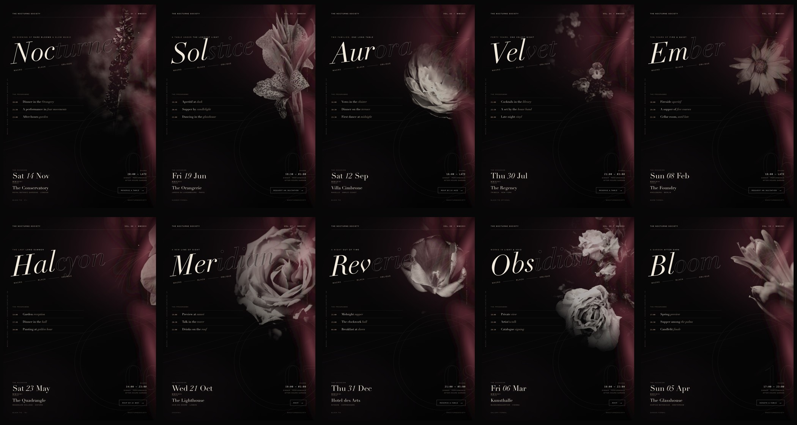

# The Nocturne Society — Occasion Series

Ten occasion posters built as one editorial system: **macro black, oblique**.
Each poster is 1200 × 1600 (3:4), rendered at 2× to 2400 × 3200 PNG.



## The series

| No. | Occasion | Venue |
| --- | --- | --- |
| 01 | Nocturne — gala | The Conservatory, London |
| 02 | Solstice — midsummer dinner | The Orangerie, Paris |
| 03 | Aurora — wedding | Villa Cimbrone, Ravello |
| 04 | Velvet — 40th birthday | The Regency, New York |
| 05 | Ember — anniversary | The Foundry, Berlin |
| 06 | Halcyon — graduation | Magdalen College, Oxford |
| 07 | Meridian — launch | The Lighthouse, Lisbon |
| 08 | Reverie — New Year | Hotel des Arts, Copenhagen |
| 09 | Obsidian — art opening | Kunsthalle, Vienna |
| 10 | Bloom — spring benefit | The Glasshouse, Amsterdam |

## Design system

- **Macro** — a single dark flower photograph per poster, screen-blended and
  graded to near-monochrome, masked so it emerges from black rather than sitting
  in a rectangle.
- **Black** — near-black stock (`#070607`), oxblood bloom gradients, bone type
  (`#efe7da`), film grain and a heavy vignette.
- **Oblique** — the display line is rotated −3° to −8°; a second oblique rule
  cuts the lower third; the photo is rotated against the text.
- **Type** — Didot italic for the occasion name (first three letters solid, the
  rest outlined), Helvetica Neue for detail, SF Mono for times and numbers.
- **Structure** — masthead / kicker / display / programme / date / venue / CTA,
  the same bones on every occasion.

## Research

Reviewed ten occasion-poster references before drawing the system. The
palettes, type scale, and oblique compositions were set from these:

- Brighton Posters — *Dark Floral, Black on Black* (after Henri Matisse), 4 views:
  [1](https://brightonposters.com/cdn/shop/files/Dark_Floral_-_Black_on_Black_-_Henri_Matisse_-_3x4_0ee8a619-37d8-4a6d-9d85-113ca18a3b54.jpg),
  [2](https://brightonposters.com/cdn/shop/files/Dark_Floral_-_Black_on_Black_-_Henri_Matisse_-_3x4_15f24dd2-ce7a-407e-b88c-6c22ae290f1b.jpg),
  [3](https://brightonposters.com/cdn/shop/files/Dark_Floral_-_Black_on_Black_-_Henri_Matisse_-_3x4_35d09838-322e-41ee-a6f7-666c6c8e18b5.jpg),
  [4](https://brightonposters.com/cdn/shop/files/Dark_Floral_-_Black_on_Black_-_Henri_Matisse_-_3x4_9be5e7c7-0e54-48b8-afd2-d1fded04dcb9.jpg)
- Dribbble poster studies:
  [4840724](https://cdn.dribbble.com/users/2172834/screenshots/4840724/media/69a1293348fe935dd8ffc6b830284448.png),
  [14568965](https://cdn.dribbble.com/users/2292993/screenshots/14568965/media/314e8d6b7e340fa092a038a8583abd29.png),
  [9711433](https://cdn.dribbble.com/users/2460559/screenshots/9711433/media/ffc3aed3d624a18585f0e37e51b544b2.png),
  [2457528](https://cdn.dribbble.com/users/546067/screenshots/2457528/media/394063ce8eab3f68c9e64a9a2b2f07ab.jpg),
  [23431339](https://cdn.dribbble.com/userupload/23431339/file/original-87a04086557663753fb5a46899622a2d.jpg),
  [26123328](https://cdn.dribbble.com/userupload/26123328/file/original-832f5bdd8d2a3304cd7fbd8493149589.jpg)
- Black event-poster template study:
  [d1csarkz](https://d1csarkz8obe9u.cloudfront.net/posterpreviews/black-event-poster-template-185de0b8c15a2673acd6f24f25b1705e_screen.jpg)

The ten reference thumbnails are in `references/contact-sheet.jpg`.

## Photography

Ten Pexels photographs, used under the [Pexels License](https://www.pexels.com/license/).
Each is cropped by the layout and colour-graded in CSS.

| Poster | Photo |
| --- | --- |
| 01 | [pexels 24523907](https://www.pexels.com/photo/24523907/) |
| 02 | [pexels 16411547](https://www.pexels.com/photo/16411547/) |
| 03 | [pexels 30752202](https://www.pexels.com/photo/30752202/) |
| 04 | [pexels 20426109](https://www.pexels.com/photo/20426109/) |
| 05 | [pexels 25460701](https://www.pexels.com/photo/25460701/) |
| 06 | [pexels 29695669](https://www.pexels.com/photo/29695669/) |
| 07 | [pexels 29909125](https://www.pexels.com/photo/29909125/) |
| 08 | [pexels 33045179](https://www.pexels.com/photo/33045179/) |
| 09 | [pexels 18302276](https://www.pexels.com/photo/18302276/) |
| 10 | [pexels 19078908](https://www.pexels.com/photo/19078908/) |

## Tools

The reference posters are Canva/Photoshop/Illustrator work. The code-native
equivalents were used here:

- **HTML + CSS + inline SVG** for the whole composition — vectors, gradients,
  type, grain, blend modes.
- **Headless Chromium via Playwright** to render at 2× (the print/preview step).
- **Didot / Didot italic** (display), **Helvetica Neue** (detail),
  **SF Mono** (numerals) — system fonts.
- **Python + Pillow** for the generator, contact sheet, and 1× previews.

## Files

```
posters/            poster-01..10.png (2400×3200), previews, contact-sheet.jpg
generated/          poster-01..10.html (the render sources)
template.html       the master layout
generate.py         event data -> generated HTML
render-many.js      Chromium batch render
events.json         the ten event records
assets/             macro-01..10.jpg (Pexels sources)
references/         contact-sheet.jpg (10 posters studied)
```

Rebuild:

```sh
python3 generate.py
node render-many.js "$PWD/generated"
```

Design and code in this folder may be reused freely. Photographs remain under
the Pexels License.
